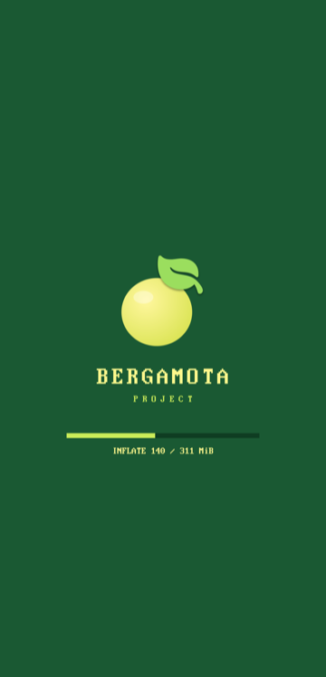

<p align="center">
  
</p>

<h1 align="center">Bergamota Project</h1>

<p align="center">
  <b>Apple's iOS 18 on a Poco F1</b><br>
  Xiaomi <code>beryllium</code> · Qualcomm Snapdragon 845 · iOS 18.7.8 (22H352)
</p>

<p align="center">
  
  
  
  
</p>

---

The Poco F1 boots the **unmodified iOS 18.7.8 userland of the iPhone XR** (`iPhone11,8`) to SpringBoard. It runs from its own UFS storage and is driven from a Mac over USB. Four parts make that work, each named after a piece of the bergamot tree:

| | Part | What it does | Where |
| --- | --- | --- | --- |
| 🍋 | **Bergamota** | The macOS control plane. It shows phone status and the live kernel log, builds boot images, and runs the boot and flash queue. A second-screen Control Plane view also handles sideloading and media upload. | [`apps/Bergamota`](apps/Bergamota) |
| 🌿 | **Enxerto** | The bootloader ("graft"). Qualcomm ABL starts it from the `boot` partition. It inflates the kernel with the MMU on, hands it a device tree and boots it. It also has its own fastboot and an off-mode charging screen. | [`enxerto/`](enxerto) |
| 🪵 | **Heartwood** | The kernel: Apple's open-source XNU (xnu-11215, the iOS 18 generation) plus our patches for the Snapdragon 845 hardware. It is built by GitHub Actions. | [`xnu/patches-11215`](xnu/patches-11215) |
| 🏴 | **Renegade** | The patcher. It rewrites every arm64e Mach-O and the whole dyld shared cache so they run on a CPU without pointer authentication. It then builds the flashable iOS root image. | [`tools/renegade`](tools/renegade) |

> [!WARNING]
> This is an experimental bring-up, not a usable phone OS. It installs into `userdata` and **erases Android's user data**. Apple's security model is mostly switched off, so do not put anything personal on it.

## The boot chain

```
Qualcomm ABL (stock, unlocked)
  └─ Enxerto            boot partition · logo + progress bar · Bergamota fastboot · charging screen
      └─ Heartwood      XNU + Apple Device Tree (@3x iPhone XR identity) + boot-args
          └─ HFS+ root  userdata · iOS 18.7.8, rewritten by Renegade
              └─ dyld → launchd → daemons → backboardd → SpringBoard
```

<p align="center">
  &nbsp;&nbsp;
  &nbsp;&nbsp;
  
</p>
<p align="center"><sub>Enxerto's screens, rendered by its host test: boot, Bergamota fastboot, off-mode charging</sub></p>

## Status

| Area | State |
| --- | --- |
| iOS | 18.7.8 (22H352) to **SpringBoard and the home screen**, with Safari, Settings and the other stock apps registered |
| CPU | All 8 cores (4× A55 + 4× A75). Instead of pointer authentication, the code is rewritten by Renegade |
| Display | 1080×2246 panel, iOS renders at @3x; page flipping on the MDP. **CPU rendering**, no GPU yet |
| Touch / buttons | Novatek NT36672A (bit-banged I²C), power and volume keys over SPMI |
| USB | CDC-ECM Ethernet: SSH at `root@192.168.7.2`, live kernel log on UDP 5140, internet shared from the Mac |
| Battery | Real fuel gauge and charger state; the off-mode charging screen lives in Enxerto |
| Kernel | Heartwood on **xnu-11215.81.4** since 2026-10-23 (it was xnu-8796, the iOS 16 generation, before that) |
| Working on | GPU acceleration on the Adreno 630 (OpenGL ES over Mesa freedreno, then Metal) |
| Not working | Wi-Fi, cellular, Bluetooth, audio, camera, sensors, SEP / Face ID, GPU acceleration |

## Getting started

You need a Mac, a Poco F1 with an **unlocked bootloader**, and a backup of its partitions (see [`NOTES.md`](NOTES.md)).

```sh
brew install --cask android-platform-tools
brew install aarch64-elf-gcc dtc blacktop/tap/ipsw
```

**0. The stock device tree.** Enxerto boots with your phone's own Qualcomm device tree (DTB). On the Poco F1 the ROM's `boot.img` is header v1. Its 21 DTBs are not in a separate section: they are appended to the gzipped kernel (`Image.gz-dtb`), so generic unpackers only give you `kernel`. `tools/extract-dtb.py` gunzips the kernel, splits off the DTBs and picks the one ABL would use:

```sh
# with the phone in OrangeFox/TWRP (adb root), save the stock boot image and the running device tree
adb pull /dev/block/by-name/boot backup/boot.img
adb pull /sys/firmware/fdt dtb/beryllium/live.dtb
python3 tools/extract-dtb.py backup/boot.img dtb/beryllium --live dtb/beryllium/live.dtb
# -> dtb/beryllium/rom-0..20.dtb and dtb/beryllium/dtb = "Beryllium MP v2.1" (msm-id 0x141 0x20001, board-id 0x45 0)
```

Without `--live`, it lists every blob (model, `qcom,msm-id`, `qcom,board-id`) and you choose with `--pick N`. `dtb/` and `backup/` are git-ignored, because they hold your phone's serial and calibration data. Enxerto's `build.sh` reads `dtb/beryllium/dtb`, or takes the path from `DTB=`.

**1. Heartwood.** The kernel builds on GitHub's macOS runners:

```sh
gh workflow run xnu.yml -R ry-diffusion/Bergamota -r develop
gh run download -R ry-diffusion/Bergamota -n xnu-kernel -D xnu/out-develop
```

**2. Renegade.** Download the iOS 18.7.8 root and build the image. No sudo is needed, but you need about 20 GB free:

```sh
tools/renegade/renegade fetch        # root dmg + SystemOS/AppOS cryptexes, decrypted
tools/renegade/renegade root         # -> research/ios18/ios18-root-full.simg
```

**3. Enxerto.** Pack the kernel, the device tree and the boot-args into a boot image:

```sh
tools/renegade/renegade boot xnu/out-develop/kernel.development.sweet   # -> research/ios18/enxerto-boot-ios18full.img
```

**4. Bergamota.** Open `apps/Bergamota/Bergamota.xcodeproj` and run it. Add the root image (to `userdata`) and the boot image to the queue. When the phone shows up in fastboot, Bergamota flashes and boots it, with a progress bar and ETA. The same queue works from the terminal:

```sh
apps/Bergamota/scripts/bergamota flash-userdata research/ios18/ios18-root-full.simg --then-boot enxerto/out/enxerto-boot-N.img
```

The first boot takes a few minutes. Then `ssh root@192.168.7.2`.

## Troubleshooting

**"I unpacked the boot image but there is no DTB."** The Poco F1 boot.img appends the DTBs to the gzipped kernel, so unpackers don't show them. Pull the latest `develop` and, with the phone in OrangeFox:

```sh
adb pull /dev/block/by-name/boot backup/boot.img
adb pull /sys/firmware/fdt dtb/beryllium/live.dtb
python3 tools/extract-dtb.py backup/boot.img dtb/beryllium --live dtb/beryllium/live.dtb
```

That writes `dtb/beryllium/dtb`, which Enxerto's `build.sh` uses.

**Bergamota shows "REMOTE HOST IDENTIFICATION HAS CHANGED".** Every new iOS root generates a new SSH host key for `192.168.7.2`, so the old entry in `~/.ssh/known_hosts` no longer matches. Remove it with `ssh-keygen -R 192.168.7.2`. If you switch between roots often, keep a separate file instead (`-o UserKnownHostsFile=~/.ssh/known_hosts_ios18`).

## Renegade, briefly

On iOS 18 every system binary is **arm64e**, but the Snapdragon 845 (ARMv8.2) has no pointer authentication. Renegade rewrites the code 4 bytes for 4 bytes, so no offset, branch, unwind table or fixup chain moves:

```
RETAA / RETAB           →  RET
BRAA / BLRAA …          →  BR / BLR
LDRAA / LDRAB           →  LDR
PACIA / AUTIA / XPACI…  →  NOP
PACGA Xd, Xn, Xm        →  EOR Xd, Xn, Xm, ROR #13
```

It does this for every Mach-O in the root and for all of the dyld shared cache. It then re-signs each binary ad hoc (keeping its identifiers and entitlements), recomputes corecrypto's FIPS HMAC and sets the HFS+ owners without root. Heartwood's side of the deal (`sweetarm64e=1`) lets arm64e binaries load and emulates FJCVTZS. See [`tools/renegade/README.md`](tools/renegade/README.md) and [`docs/IOS18_PORT.md`](docs/IOS18_PORT.md).

## Repository layout

| Path | What |
| --- | --- |
| `apps/Bergamota/` | Bergamota, the SwiftUI control plane, plus its CLI (`scripts/bergamota`) |
| `enxerto/` | Enxerto, the bare-metal bootloader (C + asm): loader, inflate, UFS, USB/DWC3, fastboot, PMIC, boot UI |
| `xnu/patches-11215/` | Heartwood, the XNU patch series (xnu-11215), applied in order by `.github/workflows/xnu.yml`; `xnu/patches/` is the older xnu-8796 series |
| `tools/renegade/` | Renegade: `pacstrip*`, `fips_rehmac`, root build, HFS+ and sparse-image tools, `dsctools` (shared-cache symbolication) |
| `tools/extract-dtb.py` | Extracts the stock DTBs from a boot.img (also the Poco F1's appended Image.gz-dtb) and picks yours |
| `tools/mkadt.py`, `mkpayload.py` | Apple Device Tree generator; kernel + ADT + boot-args payload packer |
| `tools/sweetnet/` | Small on-device tools (`sweetps`, `sweetprefs`, `sweetuicache`, …) |
| `tools/assets/`, `mk*art.py`, `mkbootlogo.py`, `mksplash.py` | Bergamota artwork for Enxerto and the ABL splash (`logo` partition) |
| `docs/` | Design notes: iOS 18 port, Bergamota fastboot and charging, GPU research, … |
| `NOTES.md` | The engineering log: every boot, crash and decision |

Not in git: partition backups, device trees, Apple firmware and root images, or anything with serial numbers or calibration data.

## Credits

This started as a fork of [ios-sweet](https://github.com/dipa-studio/ios-sweet) (iOS 16 on the Redmi Note 10 Pro). The iOS 16 days of this port are in [`docs/IOS16_README.md`](docs/IOS16_README.md). It is built on Apple's open-source releases (xnu, IOHIDFamily, libpthread, hfs), [BearSSL](https://bearssl.org), [blacktop/darwin-xnu-build](https://github.com/blacktop/darwin-xnu-build) and [ipsw](https://github.com/blacktop/ipsw), the Linux kernel's SDM845 drivers for the hardware details, and [OrangeFox Recovery](https://orangefox.download). iOS itself is Apple's and is not distributed here.
